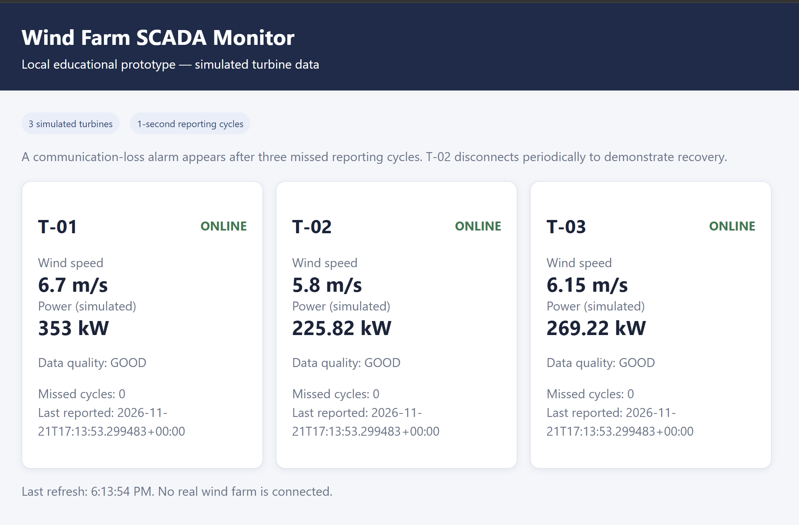
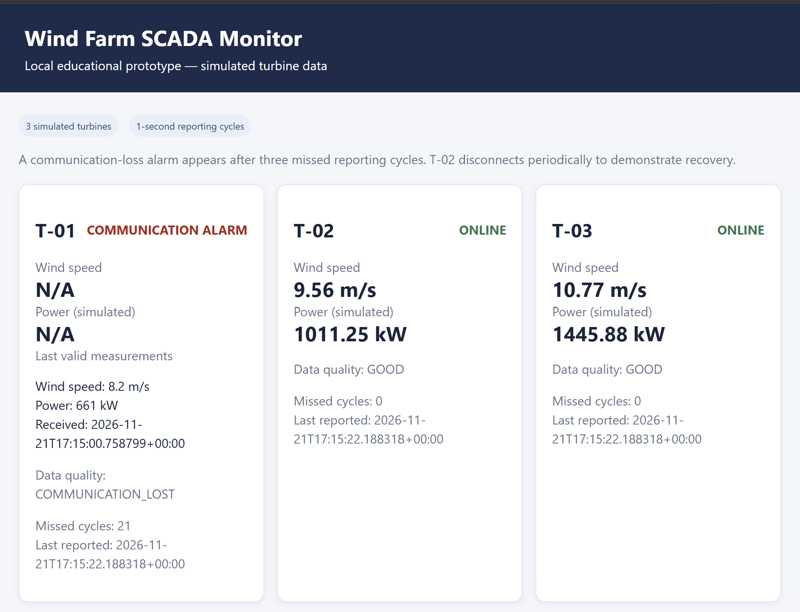

# Wind Farm SCADA Monitoring and Requirements Engineering

A Python-based educational prototype demonstrating
industrial data acquisition, communication monitoring,
alarm handling, and requirements traceability in a
simulated wind farm environment.

This project was developed as a practical exercise in
SCADA systems and requirements engineering.

## 1. Project Objectives

The project demonstrates how operational monitoring
needs can be translated into functional requirements,
implemented in software, and verified through testing.

The main objectives are:

- Acquire simulated turbine measurements using Modbus TCP.
- Monitor wind speed, power output, and connection status.
- Detect communication failures and generate alarms.
- Distinguish unavailable measurements from valid zero values.
- Preserve the last valid measurement during communication loss.
- Document functional requirements and acceptance criteria.
- Verify system behaviour through automated and manual tests.

## 2. System Architecture

The application contains three simulated turbines:

- T-01: Measurements acquired through Modbus TCP.
- T-02: Python-based simulation with periodic communication failures.
- T-03: Python-based simulation.

The monitoring application stores measurement records
in SQLite and makes the latest state available through
a local HTTP API.

```text
    Simulated Turbine T-01
              |
              v
       Modbus TCP Server
       127.0.0.1:5020
              |
              v
       Modbus TCP Client
              |
              |
    T-02 -----+----- T-03
              |
              v
      SCADA Monitoring App
              |
        +-----+-----+
        |           |
        v           v
      SQLite     Alarm Logic
        |           |
        +-----+-----+
              |
              v
          HTTP API
              |
              v
        Web Dashboard
       127.0.0.1:8000
```

All components run locally using simulated data.

## 3. Dashboard Screenshots

### Normal Operation

The monitoring application displays simulated turbine
measurements, power output, connection status, and data quality.



### Modbus TCP Communication Failure

When the Modbus TCP server is stopped, the application
detects failed polling attempts and activates a
communication-loss alarm for T-01.

Unavailable measurements are displayed as N/A.
The last valid measurements and their timestamp
remain available for inspection.



## 4. Technologies

| Technology | Purpose |
|------------|---------|
| Python | Simulation and monitoring logic |
| PyModbus 3.x | Modbus TCP communication |
| SQLite | Measurement storage |
| HTML, CSS, JavaScript | Monitoring dashboard |
| HTTP / JSON | Dashboard data access |
| unittest | Automated verification |
| Git and GitHub | Version control |

## 5. Functional Requirements

| ID | Requirement |
|----|-------------|
| FR-06 | Acquire turbine measurements through Modbus TCP |
| FR-07 | Detect communication loss after three unsuccessful polling cycles |
| FR-08 | Indicate unavailable measurement quality |
| FR-09 | Preserve the last valid measurement |
| FR-10 | Clear the alarm after communication recovery |

Detailed requirements and acceptance criteria are
available in the `requirements/` directory.

## 6. Communication Failure Scenario

The monitoring application attempts to acquire
measurements from T-01 through Modbus TCP.

When the Modbus server becomes unavailable:

1. The application detects unsuccessful polling attempts.
2. After three consecutive failures, a communication-loss
   alarm is activated.
3. Current unavailable values are displayed as N/A.
4. Previously received valid measurements remain visible
   with their timestamp.
5. The other simulated turbines continue operating.

When communication is restored, the application resumes
receiving measurements and clears the alarm.

The alarm threshold is an illustrative project assumption,
not a specification from an industrial operator.

## 7. Installation

Requirements:

- Python 3.10 or newer
- PyModbus 3.x

Create a virtual environment:

```bash
python3 -m venv .venv
source .venv/bin/activate
```

Install the dependency:

```bash
python -m pip install "pymodbus>=3.9,<4"
```

## 8. Run the Application

Start the Modbus TCP server in Terminal 1:

```bash
python -m scada_sim.modbus_server
```

Start the monitoring application in Terminal 2:

```bash
python -m scada_sim.app
```

Open the dashboard:

http://127.0.0.1:8000

To test communication loss, stop the Modbus server
while leaving the monitoring application running.

Restart the Modbus server to test recovery.

## 9. Verification

Run the automated tests:

```bash
python -m unittest discover -s tests -v
```

The tests cover turbine simulation, alarm logic,
Modbus client responses, and database persistence.

Some dashboard behaviour is verified manually.
Not every functional requirement has a complete
automated end-to-end test.

## 10. Requirements Traceability

The `requirements/` directory contains:

- Stakeholder requirements
- Functional specifications
- Acceptance criteria
- Requirements traceability matrix

These documents illustrate how an operational issue
can be translated into testable software behaviour.

## 11. Limitations and Future Work

This is a learning prototype, not a production SCADA system.

Current limitations include:

- Simulated turbine measurements only.
- No connection to real wind turbines.
- No industrial safety certification.
- No OPC UA implementation.
- No authentication or role-based access control.
- Last valid measurements are retained in application
  memory and are not restored after a restart.

Potential extensions:

- OPC UA data acquisition.
- Historical measurement visualization.
- Persistent alarm and incident history.
- Automated end-to-end communication testing.
- Improved measurement quality and timestamp handling.

## Disclaimer

This is an independent educational project.

It is not affiliated with, endorsed by, or connected
to Nordex SE, and it does not use proprietary
wind turbine software or operational data.
